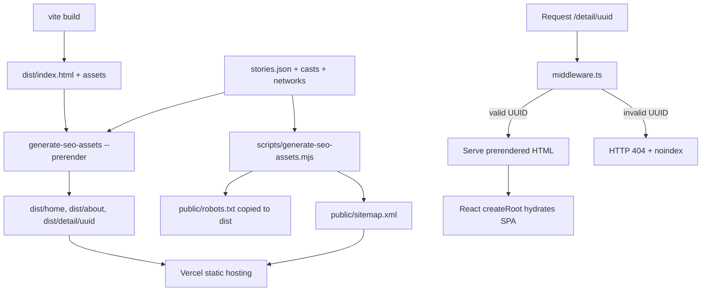

# Story Hook SEO Implementation Guide

Production site: [https://story-hook.vercel.app](https://story-hook.vercel.app)

This guide describes the **implemented** technical SEO stack for Story Hook (React 19 + Vite 6 + React Router 7 on Vercel). It does **not** guarantee Google or Bing indexing or rankings.

## Contents

| Document | Purpose |
|----------|---------|
| [IMPLEMENTATION.md](./IMPLEMENTATION.md) | Files changed, decisions, how generation works |
| [GOOGLE-SEARCH-CONSOLE.md](./GOOGLE-SEARCH-CONSOLE.md) | Manual GSC setup and indexing workflow |
| [BING-WEBMASTER.md](./BING-WEBMASTER.md) | Bing Webmaster Tools + IndexNow notes |
| [SEO-CHECKLIST.md](./SEO-CHECKLIST.md) | Practical release / maintenance checklist |

## SEO implementation overview

Story Hook remains a client-rendered SPA for interactive use. For search engines and social crawlers, production builds also emit:

1. **`public/robots.txt`** — allows crawling; declares the production sitemap
2. **`public/sitemap.xml`** — generated from `src/data/stories.json` at build time
3. **Prerendered HTML** under `dist/` for `/`, `/home`, `/about`, and every valid `/detail/:uuid`
4. **Canonical + Open Graph + Twitter + robots** meta in those HTML documents
5. **JSON-LD** (`WebSite`, `TVSeries`, `BreadcrumbList`) embedded in prerendered HTML
6. **Edge middleware** that returns **HTTP 404** for unknown drama UUIDs without overwriting valid prerenders

## Current project SEO architecture



| Layer | Role |
|-------|------|
| `index.html` | Default homepage meta (absolute production OG URLs) |
| `src/components/SEO.tsx` | Client-side title/meta/canonical/JSON-LD updates on navigation |
| `social-meta.ts` | Shared pure helpers (Edge + client) |
| `scripts/generate-seo-assets.mjs` | Sitemap + build-time HTML prerender |
| `middleware.ts` | 404 for invalid detail UUIDs; pass-through for valid prerenders |
| `vercel.json` | SPA rewrite fallback; cache headers for assets / sitemap / robots |

## Prerendering architecture

**Approach:** post-Vite **build-time static HTML generation** (no Next.js, no Puppeteer).

1. Vite builds the SPA into `dist/` (hashed JS/CSS + `index.html`).
2. `generate-seo-assets.mjs --prerender` reads `dist/index.html` as a template.
3. For each public route it:
   - injects route-specific `<title>`, description, robots, canonical, Open Graph, Twitter, JSON-LD
   - injects meaningful semantic HTML into `#root` (titles, synopsis, cover, cast, metadata), wrapped in `<main class="sr-only">` so crawlers/screen readers keep the text while sighted users see the boot splash
4. React still mounts with `createRoot` and replaces `#root` for the interactive app. Crawlers that do not execute JS still receive the prerendered content and metadata. A critical CSS boot splash outside `#root` covers the gap until `html.app-mounted` is set by `DocumentLanguage` after the app shell mounts (with a timed failed-load fallback, `:has(#root > :not(main))` CSS fallback, and `noscript` unhide).

**Pages prerendered**

| Route | Output |
|-------|--------|
| `/` | `dist/index.html` |
| `/home` | `dist/home/index.html` (canonical points to `/`) |
| `/about` | `dist/about/index.html` |
| `/detail/:uuid` | `dist/detail/:uuid/index.html` for each valid story |
| Not-found shell | `dist/404.html` (`noindex`) |

Invalid UUIDs are **not** prerendered. Middleware returns **404**.

## Sitemap generation process

```bash
node scripts/generate-seo-assets.mjs --sitemap
# also runs automatically via npm run prebuild
```

- Source of truth: `src/data/stories.json`
- Includes: `https://story-hook.vercel.app/`, `/about`, `/detail/{uuid}` for each valid drama
- Excludes: `/home` (duplicate of home), `/settings`, `/advanced-search`, query URLs, localhost
- No invented `lastmod` values (reliable modification dates are not stored in the data files)
- Adding a drama to JSON automatically includes it on the next production build

## Robots.txt configuration

File: `public/robots.txt`

- `User-agent: *` / `Allow: /`
- Does **not** block JS, CSS, fonts, or images
- Declares: `Sitemap: https://story-hook.vercel.app/sitemap.xml`

## Canonical URL strategy

| Page | Canonical |
|------|-----------|
| `/` and `/home` | `https://story-hook.vercel.app/` |
| `/about` | `https://story-hook.vercel.app/about` |
| Drama detail | `https://story-hook.vercel.app/detail/{uuid}` |
| Settings / Advanced Search / 404 | present but **`noindex, follow`** |

Canonicals always use the **production** HTTPS origin (`https://story-hook.vercel.app`), including when the client `SEO` component updates tags in the browser. This avoids preview-deployment hosts becoming the preferred URL.

Middleware no longer rewrites HTML for valid detail/home routes, so it cannot emit a second conflicting canonical on those pages.

## Metadata generation

Drama meta is derived from story fields:

- **Title:** `{title} | Story Hook`
- **Description:** prefers `{mmTitle} - {title}. {synopsis}` (truncated), using only real fields
- **Image:** absolute cover URL when valid, else `https://story-hook.vercel.app/og-default.png`
- Open Graph + Twitter tags mirror title/description/image/url
- `og:type` is `article` for dramas and `website` for home/about

## JSON-LD implementation

| Type | Where |
|------|--------|
| `WebSite` + `Organization` publisher | Homepage prerender (+ client on Home) |
| `TVSeries` | Drama detail (name, alternateName/mmTitle, description, image, countryOfOrigin, genre, numberOfEpisodes, datePublished when parseable, actor, publisher/network) |
| `BreadcrumbList` | Home / about / detail |

Rules:

- No fabricated ratings, reviews, or aggregate scores
- Missing fields are omitted
- JSON is escaped for safe HTML embedding (`<` → `\u003c`)

## English and Myanmar SEO strategy

- Catalog content stores English `title` and Myanmar `mmTitle` / `story`
- Both appear in prerendered HTML body, meta descriptions (when present), and `TVSeries.alternateName`
- UI chrome is localized via i18n; **routes are language-agnostic** (`/home`, `/detail/:uuid`, …)
- **No `hreflang` tags** are emitted — there are no separate language URLs. Adding `hreflang` would be incorrect until localized URL paths exist.

## Vercel deployment behavior

1. `npm run build` → TypeScript → Vite → prerender into `dist/`
2. Vercel publishes `dist/`
3. **Filesystem wins** before the SPA rewrite: prerendered `/detail/:uuid` is served as static HTML
4. Unknown app routes still rewrite to `index.html` (SPA)
5. Unknown **drama** UUIDs hit Edge Middleware → **HTTP 404** + `noindex`
6. `/robots.txt` and `/sitemap.xml` are static files in `dist/`

Social sharing continues to work because prerendered pages include complete Open Graph / Twitter tags in the first HTML byte stream.

## SEO validation commands

```bash
npm run generate:seo          # sitemap (+ prerender if dist exists)
npm run verify:social-meta    # sample drama OG sanity check
npm run verify:seo            # robots, sitemap, prerender HTML checks
npm run build                 # full production build including prerender
npm run lint
npm run preview               # static preview (middleware does not run locally)
```

Recommended order after code or catalog changes:

```bash
npm run build
npm run verify:seo
npm run verify:social-meta
npm run lint
```

## Troubleshooting guide

| Symptom | Likely cause | Fix |
|---------|--------------|-----|
| Sitemap missing new drama | Build not run after JSON edit | `npm run build` or `npm run generate:seo` |
| Soft 404 for missing drama | Old middleware always returned 200 | Current middleware returns 404 for unknown UUIDs |
| Duplicate canonical | Middleware + client both injecting | Valid pages use pass-through; only one canonical in prerender |
| Social preview stale | Platform cache | Rescrape in Facebook/LinkedIn debuggers |
| Preview deploy wrong host in tags | Expected for absolute production canonicals | Canonicals intentionally prefer production origin |
| `verify:seo` warns dist missing | Preview without build | Run `npm run build` first |
| Flash of unstyled prerender text | Prerender lacked visual hide / splash | Prerender root uses `sr-only` + boot splash outside `#root` until `app-mounted` |

## Manual steps outside the repo

Indexing requires account actions in Google Search Console and Bing Webmaster Tools. See:

- [GOOGLE-SEARCH-CONSOLE.md](./GOOGLE-SEARCH-CONSOLE.md)
- [BING-WEBMASTER.md](./BING-WEBMASTER.md)
